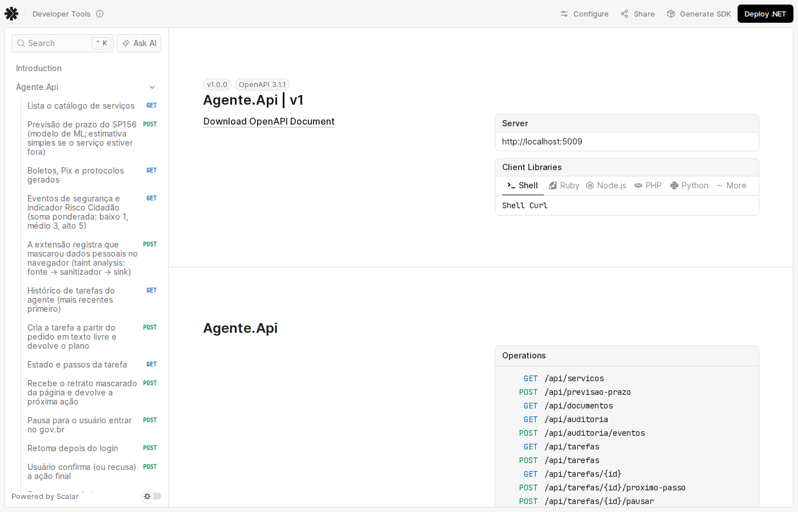
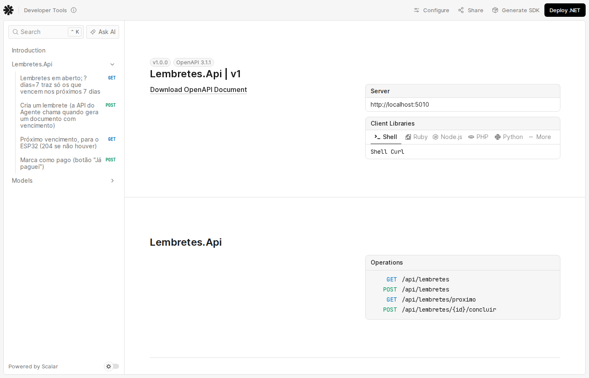
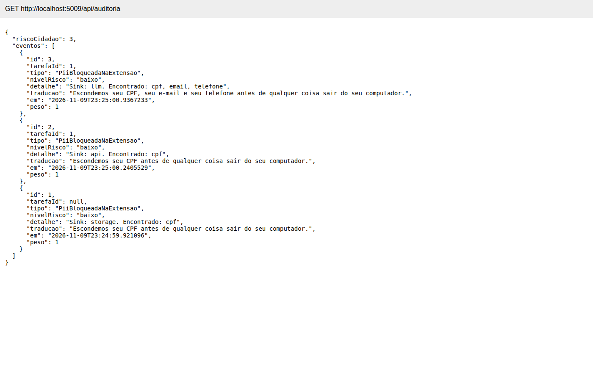

# SampaIA — Arquitetura Orientada a Serviços (SOA) e Web Services

Camada de backend da SampaIA: dois serviços REST independentes, cada um com seu banco, que conversam por HTTP. A **API do Agente** controla as tarefas que a Paulinha executa nos sites públicos; a **API de Lembretes** guarda os vencimentos que o app e o ESP32 mostram. A API do Agente também chama o serviço de previsão de prazo (Python) e o LLM.

## Integrantes

| Nome | RM |
|---|---|
| Leonardo de Farias | 555211 |
| Gustavo Laur | 556603 |
| Giancarlo Cestarolli | 555248 |

## O que tem nesta pasta

| Caminho | Conteúdo |
|---|---|
| `backend/Agente.Api` | Web API do agente: tarefas, próximo passo, pausa no login, confirmação, documentos, auditoria e proxy da previsão de prazo. Porta 5009 |
| `backend/Lembretes.Api` | Web API de lembretes de vencimento, usada pelo app e pelo ESP32. Porta 5010, com banco próprio |
| `backend/Agente.Domain` | entidades, máquina de estados da tarefa (`Tarefa.cs`), `IConector` + `ConectorBase` + 6 conectores (Sabesp, IPTU, IPVA, SP156, Poupatempo e Poupatempo simulado), contratos |
| `backend/Agente.Infra` | Entity Framework Core (`AgenteDbContext`, Oracle ou SQLite), migrações, `PiiMasker`, cliente do Claude e LLM simulado, clientes HTTP de Lembretes e da previsão |
| `backend/tests` | xUnit + Moq: domínio, mascaramento de dados, conectores, segurança e endpoints com `WebApplicationFactory` |
| `backend/evidencias` | prints da documentação Scalar dos dois serviços |
| `security/regras-pii.json` | regras de mascaramento de dados pessoais lidas pelo `PiiMasker` |

## Como a solução atende a disciplina

| Tema | Onde está |
|---|---|
| Estruturação do domínio | `Agente.Domain/Entidades.cs` e `Tarefa.cs`: estados `Planejando → Navegando ⇄ AguardandoLogin → AguardandoConfirmacao → Concluida` (ou `Falhou`); transição inválida responde HTTP 409 |
| Conexão com banco de dados | `AgenteDbContext` e `LembretesDbContext` com `Oracle.EntityFrameworkCore` (entrega) e SQLite (desenvolvimento), escolhidos pela connection string |
| Migrações | Agente: `Inicial`, `AddNivelRisco`, `AjustaServicosReais`, `AddCodigoDocumento`, `AddTraducaoEvento`, `AddPoupatempoReal`. Lembretes: `Inicial`, `AjustaIdentidadeLembrete` |
| Documentação automática | OpenAPI + Scalar em `/scalar` e `/openapi/v1.json` nos dois serviços |
| Testes automatizados | 74 testes em `backend/tests` (`dotnet test`) |
| Integração entre serviços | `ILembretesClient` (Agente → Lembretes) e `IPrevisaoPrazoClient` (Agente → previsão de prazo em Python) |

## Principais endpoints

| Serviço | Método e rota | O que faz |
|---|---|---|
| Agente | `GET /api/servicos` | serviços que a Paulinha sabe resolver |
| Agente | `POST /api/tarefas` | cria uma tarefa a partir do pedido em texto livre |
| Agente | `POST /api/tarefas/{id}/proximo-passo` | recebe o retrato mascarado da página e devolve a próxima ação |
| Agente | `POST /api/tarefas/{id}/pausar` · `/retomar` · `/confirmar` · `/falhar` | login, confirmação e encerramento |
| Agente | `GET /api/tarefas/falhas-por-servico` | falhas agrupadas por serviço (LINQ) |
| Agente | `GET /api/documentos` | boletos, agendamentos e protocolos gerados |
| Agente | `GET /api/auditoria?tarefaId=` | eventos de segurança e Risco Cidadão |
| Agente | `POST /api/previsao-prazo` | previsão de prazo de um pedido do SP156 |
| Lembretes | `GET /api/lembretes?dias=7` · `POST /api/lembretes` | lista e cria lembretes |
| Lembretes | `GET /api/lembretes/proximo` · `POST /api/lembretes/{id}/concluir` | próximo vencimento (ESP32) e "Já paguei" |
## Como rodar

Pré-requisito: [.NET 10 SDK](https://dotnet.microsoft.com/download).

```bash
cd backend
dotnet test                                  # 74 testes (68 do Agente, 6 de Lembretes)
dotnet run --project Lembretes.Api           # http://localhost:5010/scalar
dotnet run --project Agente.Api              # http://localhost:5009/scalar
```

Sem configuração nenhuma, as APIs usam **SQLite** e um **LLM simulado**, então rodam offline.

| Variável de ambiente | Efeito |
|---|---|
| `ConnectionStrings__Oracle` | usa o Oracle da FIAP em vez do SQLite |
| `ANTHROPIC_API_KEY` | usa o Claude para escolher a próxima ação do agente |
| `Lembretes__Url` | endereço da API de Lembretes (padrão `http://localhost:5010`) |

Para criar as tabelas no Oracle:

```bash
cd backend
dotnet tool restore
ConnectionStrings__Oracle="User Id=...;Password=...;Data Source=oracle.fiap.com.br:1521/ORCL" \
  dotnet ef database update -p Agente.Infra -s Agente.Infra
dotnet ef database update -p Lembretes.Api -s Lembretes.Api
```

## Evidências

| Agente.Api (`/scalar`) | Lembretes.Api (`/scalar`) |
|---|---|
|  |  |

Risco Cidadão (`GET /api/auditoria`): 

Mais detalhes (camadas, máquina de estados, migrações e consultas LINQ) em [`backend/README.md`](backend/README.md).

## Ficha da CitizenTech

| Campo | Resposta |
|---|---|
| Nome da CitizenTech | SampaIA (a assistente se chama **Paulinha**) |
| Cidade e bairro | São Paulo (SP), a cidade toda: os serviços (Sabesp, IPTU, IPVA, SP156, Poupatempo) são os mesmos em qualquer bairro |
| Cidadão beneficiado | Idosos e pessoas com pouca familiaridade digital em São Paulo, que hoje dependem de um parente ou vizinho para pagar uma conta ou marcar um atendimento |
| Problema, em uma frase | Em São Paulo o serviço público já é digital, mas quem tem pouca familiaridade com a internet fica preso em sites confusos e depende de outra pessoa para resolver coisas simples |
| Como funciona | A pessoa escreve o que precisa ("quero pagar meu IPTU"). A Paulinha, uma extensão do Chrome, monta o plano, navega no site oficial e preenche o que dá. No login gov.br ela pausa e mostra um tutorial; a pessoa entra sozinha e o agente retoma. Nada irreversível acontece sem "Confirmo". Dados pessoais são mascarados antes de ir para a IA. O app avisa vencimentos, o ESP32 dá o lembrete físico em casa e o modelo de ML estima o prazo dos pedidos do SP156 |
| O que cada parte faz | API do Agente e API de Lembretes em C#/.NET (SOA e C#), regras de dados pessoais e Risco Cidadão (Cybersecurity), previsão de prazo do SP156 (IA & ML), app Expo (Mobile), VM Linux provisionada por Bash (Operating Systems), lembrete físico com ESP32 (Physical Computing) e plano de testes no Azure Boards (Testing) |
| Ecossistema | **Cidadão:** faz o pedido, entra sozinho na conta e dá o "Confirmo". **Família ou quem ajuda:** instala a extensão e o app uma vez. **Órgãos públicos e concessionárias** (Prefeitura, Sabesp, Secretaria da Fazenda, Poupatempo, gov.br): a Paulinha usa os sites públicos como estão. **Anthropic (Claude):** decide o próximo passo e só recebe texto já mascarado. **Dados abertos da Prefeitura:** base do modelo de prazo do SP156 |
| Indicador de impacto | Tarefas concluídas sem ajuda presencial (%); tempo médio por serviço comparado a fazer sozinho; logins retomados após o tutorial (%); Risco Cidadão médio por tarefa, que deve ficar baixo |
| ODS conectados | **10 — Redução das desigualdades** (meta 10.2): a pessoa idosa resolve sozinha o que hoje depende de outra pessoa. **11 — Cidades e comunidades sustentáveis** (meta 11.3): o app ajuda a abrir e acompanhar pedidos de zeladoria no SP156 e mostra quanto tempo a Prefeitura costuma levar. **9 — Indústria, inovação e infraestrutura** (meta 9.c): IA aplicada para tornar acessíveis os serviços digitais que já existem |

---
Global Solution CitizenTech · FIAP · Engenharia de Software, 3º ano · 2º semestre de 2026. Todos os dados de teste e de demonstração são fictícios; o modelo de ML usa dados públicos e anonimizados do SP156.
