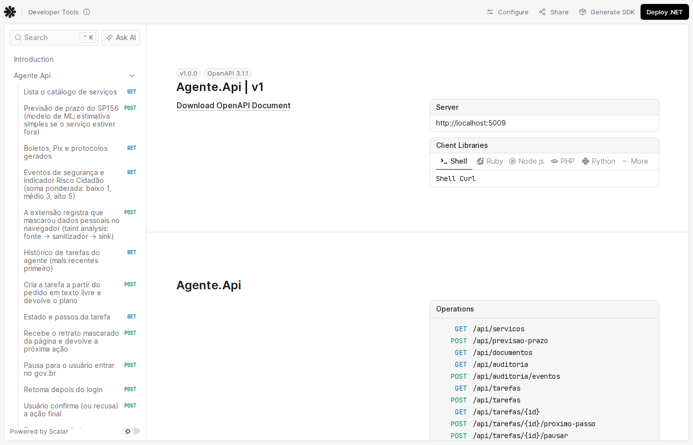
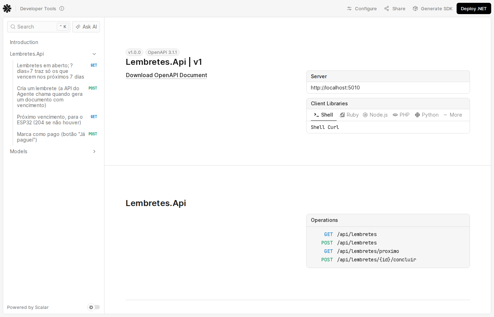
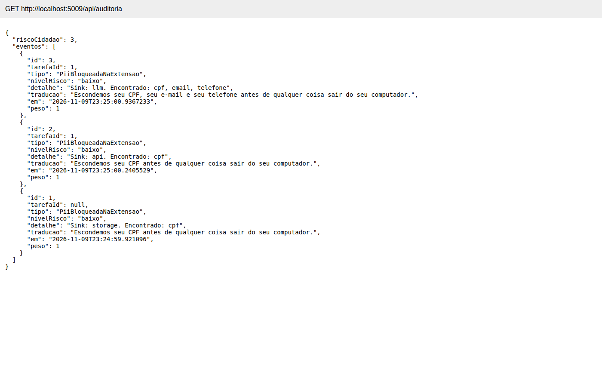

# Backend (.NET 10) — C# e SOA

Dois serviços REST independentes, cada um com seu banco:

| Serviço | Porta | Responsabilidade |
|---|---|---|
| `Agente.Api` | 5009 | Tarefas do agente, próximo passo, handoff de login, confirmação, documentos, auditoria, proxy da previsão de prazo |
| `Lembretes.Api` | 5010 | Lembretes de vencimento (app e ESP32). A API do Agente chama este serviço por HTTP (`ILembretesClient`) |

## Camadas

| Projeto | Conteúdo |
|---|---|
| `Agente.Domain` | Entidades, máquina de estados (`Tarefa.MudarPara`), `IConector` + `ConectorBase` + 5 conectores, `ConectorFactory` (Strategy), contratos (`ILlmClient`, `IPiiMasker`, `ILembretesClient`, `IPrevisaoPrazoClient`) |
| `Agente.Infra` | EF Core (`AgenteDbContext`, Oracle ou SQLite), migrações, `PiiMasker`, `LlmFake` e `ClaudeLlmClient`, clientes HTTP |
| `Agente.Api` | Minimal APIs, `TarefaService`, tratamento de erros, OpenAPI + Scalar |
| `Lembretes.Api` | Entidade, `LembretesDbContext`, migração e endpoints |
| `tests/` | xUnit + Moq (domínio, PII, conectores) e `WebApplicationFactory` (endpoints) |

## Máquina de estados da tarefa

```
Planejando → Navegando ⇄ AguardandoLogin
Navegando → AguardandoConfirmacao → Navegando | Concluida
Navegando → Concluida
qualquer estado aberto → Falhou
```
Transição inválida lança `TransicaoInvalidaException` (HTTP 409).

## Migrações

| Banco | Migrações |
|---|---|
| Agente (Oracle) | `Inicial` → `AddNivelRisco` → `AjustaServicosReais` → `AddCodigoDocumento` → `AddTraducaoEvento` |
| Lembretes (Oracle) | `Inicial` |

Geradas para Oracle (o banco da entrega). Em desenvolvimento e nos testes, o SQLite cria as tabelas direto. Ao mudar o modelo, apague `Agente.Api/agente.db` e `Lembretes.Api/lembretes.db` para recriar.

## Consultas LINQ

- `GET /api/lembretes?dias=7`: lembretes em aberto dos próximos 7 dias.
- `GET /api/tarefas/falhas-por-servico`: tarefas que falharam, agrupadas por serviço.
- `GET /api/auditoria?tarefaId=`: eventos e Risco Cidadão (soma ponderada).

## Rodar e testar

```bash
dotnet test                                  # 66 testes
dotnet run --project Lembretes.Api           # http://localhost:5010/scalar
dotnet run --project Agente.Api              # http://localhost:5009/scalar
```

| Rubrica | Onde aparece |
|---|---|
| SOA: domínio | `Agente.Domain/Entidades.cs`, `Tarefa.cs` |
| SOA: banco · migrações | `AgenteDbContext`, `LembretesDbContext`, pastas `Migrations/` |
| SOA: documentação · testes | `/scalar` e `/openapi/v1.json` nos dois serviços; `tests/` |
| C#: POO | `IConector` → `ConectorBase` → 5 conectores; `IConectorFactory` (Strategy) |
| C#: Web API · EF + LINQ | `Program.cs` dos dois serviços; consultas acima |
| C#: async · qualidade | todo I/O com `async/await` e `CancellationToken`; DI em `DependencyInjection.cs` |

## Evidências

| Agente.Api (`/scalar`) | Lembretes.Api (`/scalar`) |
|---|---|
|  |  |

Risco Cidadão (`GET /api/auditoria`) depois do `npm run e2e:taint`: 
