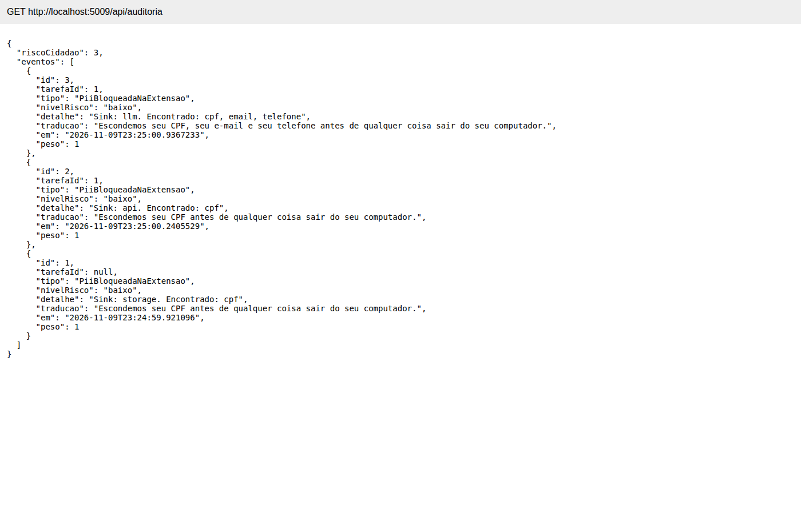

# SampaIA — Cybersecurity

O agente lê páginas cheias de dados pessoais e manda trechos para um LLM externo. Este módulo garante que **nenhum dado sensível chegue ao LLM, aos logs ou ao armazenamento sem passar pelo mascaramento**, registra cada bloqueio como evento de auditoria e resume o risco em um indicador simples, o **Risco Cidadão**.

**Vídeo:** https://youtu.be/O8g4YKnLzHQ ([`videos/cybersecurity-risco-cidadao.mp4`](videos/cybersecurity-risco-cidadao.mp4))

## Integrantes

| Nome | RM |
|---|---|
| Leonardo de Farias | 555211 |
| Gustavo Laur | 556603 |
| Giancarlo Cestarolli | 555248 |

## O que tem nesta pasta

| Caminho | Conteúdo |
|---|---|
| `security/regras-pii.json` | regras de PII usadas pelos dois lados: CPF, RG, CNH/Renavam, Cartão SUS, cartão, Pix, boleto, e-mail, telefone, CEP/endereço, saúde e senha |
| `security/README.md` | explicação completa: mapeamento de PII, taint analysis (fontes, sanitizador e saídas), eventos e cálculo do Risco Cidadão |
| `security/evidencias/` | saídas do teste de taint (`e2e-taint-cpf.txt`), prova de que a extensão não lê o login (`e2e-fluxo-login.txt`), prints da extensão, da API e do portal |
| `extension/lib/pii.ts` e `pii.test.ts` | mascaramento no navegador (extensão do Chrome) e seus testes |
| `extension/entrypoints/content.ts`, `background.ts` | onde o sanitizador é aplicado: ao ler a página e antes de salvar ou enviar |
| `extension/wxt.config.ts` | manifest da extensão, **sem permissão** no gov.br e em telas de pagamento |
| `extension/e2e/taint-cpf.mjs` | teste ponta a ponta que injeta um CPF fictício na página e confere que ele não sai do navegador |
| `backend/Agente.Infra/PiiMasker.cs` | mascaramento no servidor, com as mesmas regras |
| `backend/Agente.Api/TarefaService.cs`, `Program.cs` | mascaramento antes de gravar e de chamar o LLM; endpoint `/api/auditoria` |
| `backend/Agente.Domain/Entidades.cs`, `Contratos.cs` | evento de auditoria e nível de risco |
| `backend/Agente.Infra/Llm.cs` | tradução dos eventos para linguagem simples |
| `backend/tests/.../PiiMaskerTests.cs`, `SegurancaTests.cs` | testes das regras e prova de que o CPF não aparece em log, banco, auditoria nem no que vai ao LLM |
| `mobile/prints/app-seguranca.png` | tela Segurança do app com o Risco Cidadão |
| `videos/` | vídeo da atividade e do painel gerando o Risco Cidadão |

## Como funciona

1. **Mapeamento de PII:** as regras de `regras-pii.json` trocam cada dado por um marcador (`[CPF]`, `[DOC]`, `[PAGAMENTO]`...). Senha é bloqueio total. Valores que a tarefa precisa (número SQL do IPTU, Renavam) viram marcadores que só são trocados de volta dentro da extensão.
2. **Taint analysis:** tudo que vem da página ou do chat é tratado como contaminado. O sanitizador roda no navegador, de novo na API e de novo antes do LLM. As saídas protegidas são o LLM, os logs da API, o banco, o `chrome.storage` e o console.
3. **Eventos:** cada bloqueio gera um `EventoAuditoria` com nível baixo, médio ou alto e uma frase simples para o cidadão ("Escondemos seu CPF antes de qualquer coisa sair do seu computador").
4. **Risco Cidadão:** soma ponderada dos eventos (baixo 1, médio 3, alto 5), por tarefa ou geral, em `GET /api/auditoria`. Aparece na tela Segurança do app.
5. **Fronteira do navegador:** a extensão não tem permissão no gov.br, então o próprio navegador impede a leitura da página de login.

| Risco Cidadão na API | Tela Segurança no app |
|---|---|
|  |  |

## Ficha da CitizenTech

| Campo | Resposta |
|---|---|
| Nome da CitizenTech | SampaIA (a assistente se chama **Paulinha**) |
| Cidade e bairro | São Paulo (SP), a cidade toda: os serviços (Sabesp, IPTU, IPVA, SP156, Poupatempo) são os mesmos em qualquer bairro |
| Cidadão beneficiado | Idosos e pessoas com pouca familiaridade digital em São Paulo, que hoje dependem de um parente ou vizinho para pagar uma conta ou marcar um atendimento |
| Problema, em uma frase | Em São Paulo o serviço público já é digital, mas quem tem pouca familiaridade com a internet fica preso em sites confusos e depende de outra pessoa para resolver coisas simples |
| Como funciona | A pessoa escreve o que precisa ("quero pagar meu IPTU"). A Paulinha, uma extensão do Chrome, monta o plano, navega no site oficial e preenche o que dá. No login gov.br ela pausa e mostra um tutorial; a pessoa entra sozinha e o agente retoma. Nada irreversível acontece sem "Confirmo". Dados pessoais são mascarados antes de ir para a IA. O app avisa vencimentos, o ESP32 dá o lembrete físico em casa e o modelo de ML estima o prazo dos pedidos do SP156 |
| O que cada parte faz | API do Agente e API de Lembretes em C#/.NET (SOA e C#), regras de dados pessoais e Risco Cidadão (Cybersecurity), previsão de prazo do SP156 (IA & ML), app Expo (Mobile), VM Linux provisionada por Bash (Operating Systems), lembrete físico com ESP32 (Physical Computing) e plano de testes no Azure Boards (Testing) |
| Ecossistema | **Cidadão:** faz o pedido, entra sozinho na conta e dá o "Confirmo". **Família ou quem ajuda:** instala a extensão e o app uma vez. **Órgãos públicos e concessionárias** (Prefeitura, Sabesp, Secretaria da Fazenda, Poupatempo, gov.br): a Paulinha usa os sites públicos como estão. **Anthropic (Claude):** decide o próximo passo e só recebe texto já mascarado. **Dados abertos da Prefeitura:** base do modelo de prazo do SP156 |
| Indicador de impacto | Tarefas concluídas sem ajuda presencial (%); tempo médio por serviço comparado a fazer sozinho; logins retomados após o tutorial (%); Risco Cidadão médio por tarefa, que deve ficar baixo |
| ODS conectados | **10 — Redução das desigualdades** (meta 10.2): a pessoa idosa resolve sozinha o que hoje depende de outra pessoa. **11 — Cidades e comunidades sustentáveis** (meta 11.3): o app ajuda a abrir e acompanhar pedidos de zeladoria no SP156 e mostra quanto tempo a Prefeitura costuma levar. **9 — Indústria, inovação e infraestrutura** (meta 9.c): IA aplicada para tornar acessíveis os serviços digitais que já existem |

---
Global Solution CitizenTech · FIAP · Engenharia de Software, 3º ano · 2º semestre de 2026. Todos os dados de teste e de demonstração são fictícios; o modelo de ML usa dados públicos e anonimizados do SP156.
