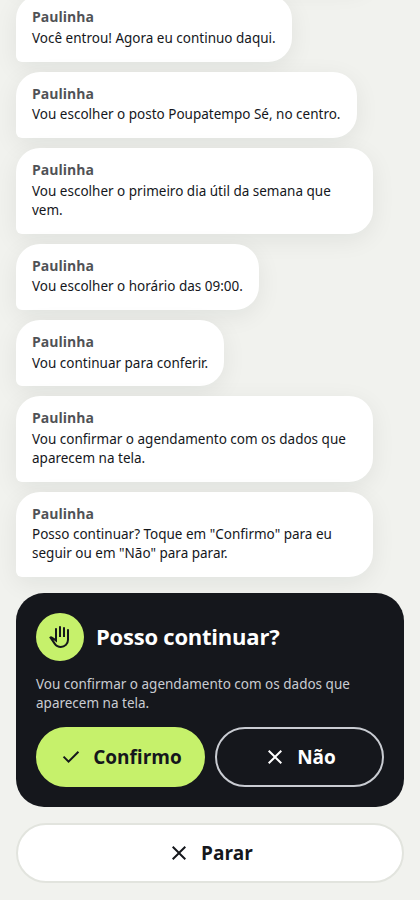
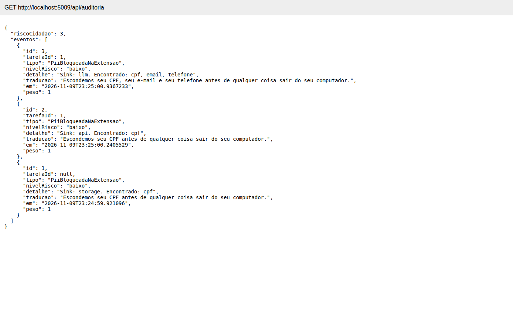
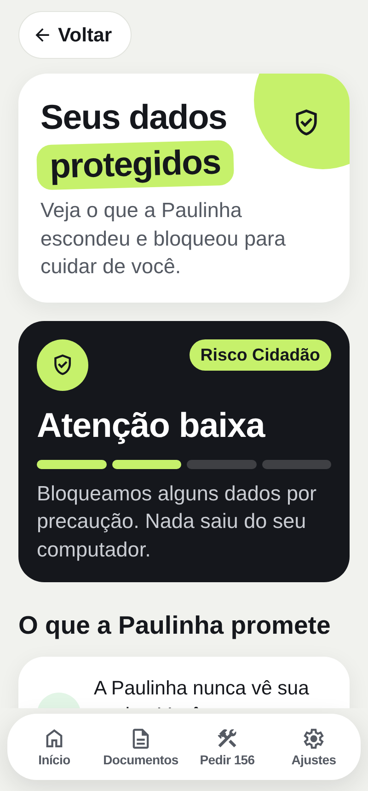

# Cybersecurity — SampaIA

O agente lê páginas cheias de dados pessoais e manda trechos para um LLM externo. A missão é garantir que **nenhum dado sensível chegue ao LLM, aos logs ou ao armazenamento sem passar pelo mascaramento**.

**Vídeo** (atividade e painel gerando o Risco Cidadão): [`videos/cybersecurity-risco-cidadao.mp4`](../videos/cybersecurity-risco-cidadao.mp4) · YouTube: https://youtu.be/O8g4YKnLzHQ

## 1. Mapeamento de PII: regras novas no motor de parsing

As regras ficam em [`regras-pii.json`](regras-pii.json) e são lidas pelos **dois lados**: `PiiMasker` em C# (API) e `lib/pii.ts` (extensão). Os testes dos dois lados usam os mesmos casos.

| Regra | Detecta | Substitui por | Validação |
|---|---|---|---|
| `senha` | "senha:", "código de verificação =" com valor; campos `type=password` | **bloqueio total** (`[BLOQUEADO]`) | campo de senha nunca é lido pelo content script |
| `pix-copia-e-cola` | payload EMV (`000201…6304XXXX`) | `[PAGAMENTO]` | |
| `boleto-bancario` / `boleto-arrecadacao` | linha digitável de 47/48 dígitos | `[PAGAMENTO]` | |
| `cns` | Cartão SUS, 15 dígitos | `[SAUDE]` | soma ponderada módulo 11 |
| `cpf` | 11 dígitos com ou sem máscara | `[CPF]` | dígitos verificadores |
| `cartao` | 13 a 19 dígitos | `[PAGAMENTO]` | Luhn |
| `email`, `telefone` | formatos brasileiros | `[EMAIL]`, `[TEL]` | |
| `rg` | `00.000.000-0` | `[DOC]` | |
| `cep`, `logradouro` | CEP e "Rua/Av./Travessa… , nº" | `[ENDERECO]` | |
| `saude` | diagnóstico, CID, prontuário, receita/laudo médico | `[SAUDE]` | |
| `documento-numerico` | CNH, Renavam, CIN e CPF com dígito errado (9 a 11 dígitos que sobraram) | `[DOC]` | |

Valores necessários à tarefa (SQL do imóvel, Renavam) viram **marcadores** (`[SQL]`, `[RENAVAM]`). O usuário digita o valor no painel; ele fica só na memória do service worker (`cofre`) e é trocado pelo valor real no momento de preencher a página. O LLM só vê o marcador.

## 2. Taint analysis

```
FONTES (tainted)                 SANITIZADOR            SINKS (saídas inseguras)
DOM lido pelo content script ─┐                    ┌─→ requisição ao LLM (Claude)
texto digitado no chat ───────┼─→  mascarar() ─────┼─→ logs da API
                              │   (TS e C#)        ├─→ EventoAuditoria.Detalhe / banco
                              │                    ├─→ chrome.storage.session
                              │                    └─→ console
```

| Sink | Onde o sanitizador é aplicado | Defesa extra |
|---|---|---|
| LLM | content script (`retrato()`), de novo em `api.proximoPasso` e de novo no servidor (`ConectorBase.ProximoPassoAsync`) | o valor que o LLM devolve também é mascarado |
| API / banco | `api.criarTarefa` mascara o chat; `TarefaService` mascara intenção e passos antes de gravar | |
| Logs | a API nunca registra conteúdo de página; evento só guarda **nomes de regras** | teste que captura todo log da API |
| `EventoAuditoria.Detalhe` | só nomes de regras de uma lista fechada (texto livre enviado pela extensão é descartado) | |
| `chrome.storage` | `salvar()` no service worker mascara o histórico | valores reais só em memória |
| console | o código não escreve dados de página no console | |

**Bloqueio e evento:** quando o sanitizador encontra PII, o dado é substituído e um `EventoAuditoria` é criado:
- `PiiBloqueadaNaExtensao` (nível baixo): mascarado no navegador, nada saiu. A extensão avisa o servidor.
- `PiiSemMascaraDaExtensao` (nível médio): o servidor recebeu PII sem máscara e bloqueou antes do LLM.
- `PiiNoChat` (baixo), `SenhaNoChat` / `SenhaNaPagina` (alto).

**Fronteira do navegador:** a extensão **não tem `host_permissions`** em `*.acesso.gov.br` nem em pagamento. O navegador impede a leitura, não só o código (evidência no E2E abaixo).

## 3. Tradução via IA e Risco Cidadão

- Cada evento recebe nível (baixo, médio, alto) e uma **frase simples** gerada pelo LLM (`ILlmClient.TraduzirEventoAsync`), por exemplo: "Escondemos seu CPF antes de qualquer coisa sair do seu computador." O evento enviado ao LLM só tem tipo, nível e nomes de regras: nunca o valor. Sem chave do LLM (ou se ele recusar), usa as frases prontas de `Traducoes`.
- **Risco Cidadão** = soma ponderada dos eventos (baixo 1, médio 3, alto 5), por tarefa ou geral: `GET /api/auditoria?tarefaId=`. Aparece na tela **Segurança** do app.

## Evidências

| Evidência | Como reproduzir | Resultado |
|---|---|---|
| CPF injetado na página não sai do navegador | `cd extension && npm run e2e:taint` (página `portal-simulado/portal/teste-pii.html`) | [`evidencias/e2e-taint-cpf.txt`](evidencias/e2e-taint-cpf.txt) |
| Extensão não consegue ler o login | `cd extension && npm run e2e` (passo 2: "Receiving end does not exist") | [`evidencias/e2e-fluxo-login.txt`](evidencias/e2e-fluxo-login.txt) |
| Nada irreversível sem o "Confirmo" da pessoa | `cd extension && npm run e2e` (passo 3) |  [`evidencias/extensao-painel.png`](evidencias/extensao-painel.png) |
| CPF não aparece em log, banco, auditoria nem no que vai ao LLM | `dotnet test --filter SegurancaTests` | `backend/tests/Agente.Tests/SegurancaTests.cs` |
| Cada regra de PII (C# e TS) | `dotnet test --filter PiiMaskerTests` · `cd extension && npm test` | |
| Painel do Risco Cidadão com os eventos do taint | `npm run e2e:taint`, depois `GET /api/auditoria` e tela Segurança do app |   |
| gov.br fora do manifest | `cd extension && npm test` (`config.test.ts`) e `.output/chrome-mv3/manifest.json` | |

Todos os dados das evidências são **fictícios** (CPF gerado com dígitos válidos, nome "Maria Teste").

## Como gerar o ZIP da entrega

```bash
bash security/empacotar.sh   # gera security/entrega-cybersecurity.zip (fora do git)
```

Leva este README, `regras-pii.json`, `evidencias/`, o código do módulo (`extension/lib/pii.ts`, `backend/Agente.Infra/PiiMasker.cs`), os pontos onde o sanitizador é aplicado (content script, service worker, `TarefaService`, `/api/auditoria`), o manifest (`wxt.config.ts`) e os testes. Rode o `npm run e2e:taint` antes, para as evidências estarem atualizadas.
