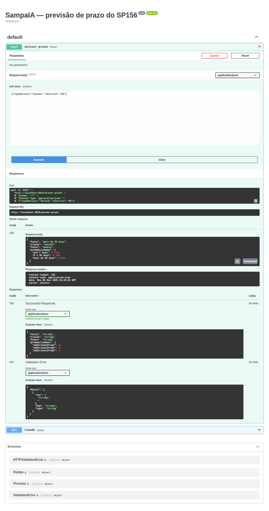

# IA & ML — previsão de prazo do SP156

Pergunta: **em quanto tempo um pedido de zeladoria do SP156 é atendido?** (até 7 dias · 8 a 30 dias · mais de 30 dias)

| Arquivo | O que é |
|---|---|
| `notebook.ipynb` | Notebook executado no Google Colab (GPU T4): dados, exploração, Regressão Logística (base), MLP em PyTorch com 12 combinações e validação cruzada, métricas treino × teste, curva de erro, conclusão |
| `preparar.py` | Limpeza, codificação e a rede `RedePrazo` (usados pelo notebook e pelo serviço) |
| `baixar_dados.py` | Baixa os CSVs reais pela API do Portal de Dados Abertos |
| `gerar_distritos.py` | Gera `mobile/src/lib/distritos.ts`: o centro (mediana de lat/lon) de cada distrito, para o app achar o bairro sem mandar a posição para fora |
| `dados/README.md` | Fonte, licença, período, colunas e recorte |
| `servico.py` | FastAPI `POST /prever-prazo` (porta 8010) |
| `modelo.joblib` | Pesos da rede + colunas + padronização (58 KB) |
| `test_servico.py` | Testes do serviço (`pytest`) |

Resultado no teste: **MLP recall macro 0,705, acurácia 0,681** (Regressão Logística: 0,657 e 0,674). Relatório completo em [`RELATORIO_ML.md`](RELATORIO_ML.md).

```bash
python3 -m venv .venv && .venv/bin/pip install -r requirements.txt   # torch CPU
.venv/bin/uvicorn servico:app --port 8010   # usa o modelo.joblib já treinado
.venv/bin/pytest
```

**Treinar de novo (Google Colab):** suba `notebook.ipynb` (File → Upload notebook), ambiente GPU T4, e envie `preparar.py` e `baixar_dados.py` para os arquivos da sessão. *Run all* baixa os CSVs do portal (~10 min) e treina (~3 min); a última célula baixa `resultados.zip` (`modelo.joblib` + `prints/`). Localmente também roda: `.venv/bin/python baixar_dados.py` e `.venv/bin/jupyter nbconvert --to notebook --execute --inplace notebook.ipynb`.

## Evidência

`POST /prever-prazo` executado no `/docs` (FastAPI): 
