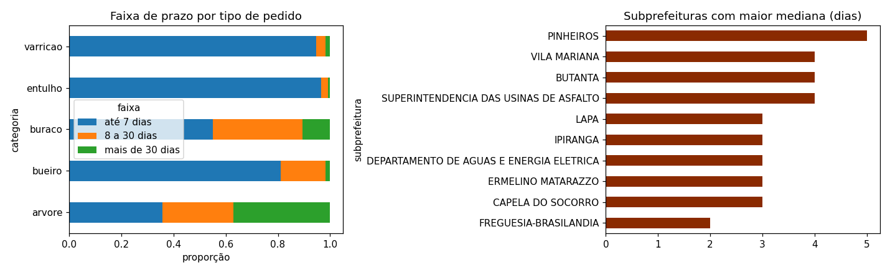
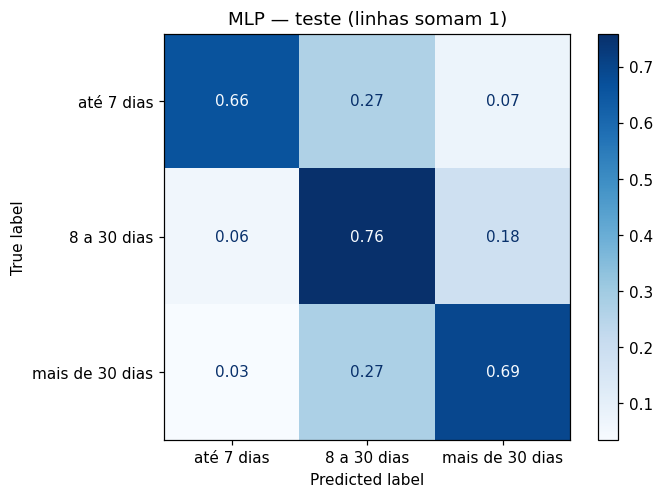
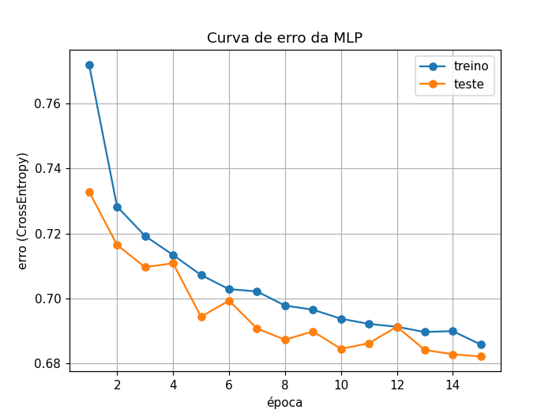

# Relatório de IA & ML — Em quanto tempo um pedido de zeladoria do SP156 é atendido?

**Projeto:** SampaIA (Global Solution CitizenTech, FIAP) · **Vídeo:** https://youtu.be/LKwL2Yb8uCs · **Notebook:** [`ml/notebook.ipynb`](notebook.ipynb) (executado no Google Colab, GPU T4) · **Serviço:** `POST /prever-prazo` ([`ml/servico.py`](servico.py)) · **Vídeo:** [`videos/ia-ml-prazo-sp156.mp4`](../videos/ia-ml-prazo-sp156.mp4)

## 1. Problema e pergunta

Quem pede ao SP156 um conserto no bairro (buraco, entulho, árvore, bueiro, varrição) não sabe quanto vai esperar. Sem essa expectativa, a pessoa liga de novo, abre pedidos repetidos ou desiste. A pergunta do modelo é:

> **Quando um cidadão abre um pedido de zeladoria no SP156, em quanto tempo ele deve ser atendido?**

A resposta aparece no app do SampaIA no momento do pedido: *"Pedidos como o seu costumam levar de 8 a 30 dias."* O alvo tem **3 faixas**: até 7 dias · 8 a 30 dias · mais de 30 dias.

## 2. Dados

| Item | Valor |
|---|---|
| Fonte | [Dados do SP156 — Portal de Dados Abertos da Prefeitura de SP](https://dados.prefeitura.sp.gov.br/dataset/dados-do-sp156) (SMIT), licença CC0 |
| Arquivos | 4 trimestres: 3º e 4º de 2025, 1º e 2º de 2026, baixados direto do portal pelo próprio notebook (`baixar_dados.py`) |
| Volume | 2.023.061 pedidos no total → **373.838 pedidos de zeladoria finalizados** |
| Período | aberturas de 01/07/2025 a 30/06/2026 |
| Alvo | `Data de Finalização` − `Data de Abertura`, em dias, agrupado em 3 faixas |

O recorte de zeladoria tem 10 serviços do SP156, agrupados em 5 categorias (detalhes em [`dados/README.md`](dados/README.md)). O modelo usa estas variáveis: tipo do pedido, subprefeitura, distrito, canal de abertura, mês e dia da semana. Logradouro, número, CEP e coordenadas **não** entram.

**Distribuição do alvo:** até 7 dias 72,8% · 8 a 30 dias 16,2% · mais de 30 dias 11,0%.



| Categoria | Pedidos | Mediana (dias) | 90% fecham em até |
|---|---|---|---|
| entulho | 151.509 | 1 | 4 dias |
| buraco | 86.033 | 6 | 32 dias |
| árvore | 81.273 | 17 | 99 dias |
| varrição | 32.790 | 1 | 4 dias |
| bueiro | 22.233 | 1 | 16 dias |

## 3. Escolha do modelo

**MLP (rede neural) em PyTorch**, um dos modelos aceitos pela GS. O tempo de atendimento depende de **combinações** de variáveis: árvore em Itaquera demora muito mais do que "árvore" e "Itaquera" indicariam separadamente. Um modelo linear soma os efeitos um a um. As camadas ocultas da rede conseguem aprender essas combinações. Para provar que a rede vale a pena, ela é comparada com uma **Regressão Logística** como linha de base.

## 4. Preparação e divisão

- **Limpeza** (`preparar.py`, o mesmo código no treino e no serviço): só serviços de zeladoria; status *Finalizada*; datas válidas; tempo negativo descartado; textos padronizados em maiúsculas.
- **Codificação:** tipo, subprefeitura, distrito e canal viram colunas 0/1 (149 colunas no total); mês e dia da semana entram como números. As colunas são aprendidas **só no treino**, e o teste é alinhado a elas.
- **Divisão:** 80/20 estratificada (299.070 pedidos no treino, 74.768 no teste), semente 42. Depois, padronização com `StandardScaler` ajustado no treino.
- **Desbalanceamento:** a métrica principal é o **recall macro** (média do recall das 3 faixas). Chutar sempre "até 7 dias" daria 73% de acurácia e recall macro 0,33. Os dois modelos dão mais peso às faixas raras.

## 5. Treino com diferentes hiperparâmetros

A rede tem duas camadas ocultas com `relu` e `Dropout(0,2)`, é treinada com Adam em lotes de 1024 pedidos e tem peso por classe. Foram testadas **12 combinações de 3 hiperparâmetros**, com **validação cruzada `StratifiedKFold` de 5 partes só no treino**. A busca usou uma amostra estratificada de 60 mil pedidos do treino; em cada parte, as colunas 0/1 e a padronização foram reaprendidas só com os dados de treino daquela rodada.

| Neurônios | Taxa | Épocas | Recall treino (CV) | Recall validação (CV) |
|---|---|---|---|---|
| **64** | **0,01** | **15** | 0,712 | **0,692 ± 0,006** |
| 128 | 0,001 | 15 | 0,712 | 0,691 ± 0,008 |
| 64 | 0,001 | 15 | 0,707 | 0,690 ± 0,010 |
| 128 | 0,01 | 5 | 0,700 | 0,686 ± 0,008 |
| 128 | 0,01 | 15 | 0,718 | 0,685 ± 0,009 |
| 16 | 0,01 | 15 | 0,700 | 0,685 ± 0,010 |
| 64 | 0,01 | 5 | 0,695 | 0,682 ± 0,009 |
| 16 | 0,001 | 15 | 0,689 | 0,676 ± 0,008 |
| 16 | 0,01 | 5 | 0,687 | 0,675 ± 0,007 |
| 128 | 0,001 | 5 | 0,685 | 0,674 ± 0,007 |
| 64 | 0,001 | 5 | 0,675 | 0,666 ± 0,007 |
| 16 | 0,001 | 5 | 0,667 | 0,660 ± 0,007 |

Mais épocas melhoram todas as combinações. A rede maior (128 neurônios, taxa 0,01) tem o melhor treino (0,718), mas a validação cai: é o começo de overfitting. A combinação escolhida foi a de **64 neurônios, taxa 0,01 e 15 épocas**, treinada depois com o treino inteiro.

## 6. Resultados em treino e teste

| Modelo | Acurácia treino | Acurácia teste | Recall macro treino | Recall macro teste |
|---|---|---|---|---|
| Regressão Logística | 0,676 | 0,674 | 0,659 | 0,657 |
| **MLP** | 0,685 | **0,681** | 0,710 | **0,705** |

| Faixa (teste, MLP) | Precisão | Recall | F1 |
|---|---|---|---|
| até 7 dias | 0,973 | 0,662 | 0,788 |
| 8 a 30 dias | 0,354 | 0,759 | 0,483 |
| mais de 30 dias | 0,484 | 0,693 | 0,570 |



No teste, a MLP supera a linha de base em recall macro por **+0,048**. A maior parte dos erros é "para cima": 27% dos pedidos que fecharam em até 7 dias foram previstos como 8 a 30 dias, e só 7% como mais de 30 dias. Para o cidadão, ouvir um prazo um pouco maior é melhor do que ouvir um prazo curto que não se cumpre. O erro contrário também existe: 27% dos pedidos que passaram de 30 dias receberam a faixa de 8 a 30 dias, ou seja, cerca de 1 em cada 4 pedidos demorados recebe uma previsão otimista.

**Overfitting:** não há. A diferença entre treino e teste é de 0,005 no recall macro e de 0,004 na acurácia. Na curva de erro, as duas linhas caem juntas até a última época. O erro de teste fica levemente abaixo do de treino porque o `Dropout` só age no treino.



## 7. Leitura para o cidadão

- **Entulho, varrição e bueiro** costumam ser resolvidos em poucos dias (mediana de 1 dia).
- **Tapa-buraco** leva cerca de uma semana, e 1 em cada 10 passa de um mês.
- **Árvore** é o pedido mais demorado: mediana de 17 dias, e 1 em cada 10 passa de 99 dias.
- **O modelo acerta o suficiente?** Ele reconhece 7 de cada 10 pedidos demorados e 3 de cada 4 pedidos de 8 a 30 dias. Isso basta para dar uma **expectativa honesta**, mas não para prometer uma data. Por isso o app usa a frase "costumam levar" e mostra a fonte ("calculado com dados públicos do SP156").

**Limites:**
- Só entram pedidos finalizados. Os que continuam abertos tendem a ser os mais longos, então os prazos reais podem ser um pouco maiores.
- "Finalizado" no sistema nem sempre quer dizer que o problema foi resolvido na rua.
- O recorte cobre um ano e pode mudar com contratos e com a época do ano.

## 8. Integração

O notebook exporta `ml/modelo.joblib`, com os pesos da rede, as colunas, a média e a escala da padronização, o mapa distrito → subprefeitura e as métricas. O serviço FastAPI `POST /prever-prazo` recebe `{tipoServico, distrito, dataAbertura}` e devolve a faixa e as probabilidades. A API do Agente expõe `POST /api/previsao-prazo` para o app; se o serviço de ML estiver fora do ar, ela responde com a faixa mais comum do tipo de pedido (`fonte: "estimativa"`).

```bash
cd ml && .venv/bin/uvicorn servico:app --port 8010
curl -X POST localhost:8010/prever-prazo -H 'Content-Type: application/json' \
  -d '{"tipoServico":"Árvore (poda ou queda)","distrito":"ITAQUERA"}'
```
