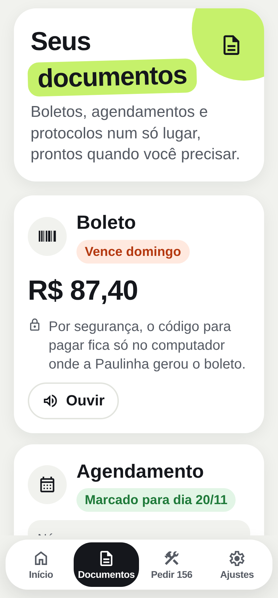

# SampaIA — Mobile Development & IOT

App do celular da SampaIA, feito em **React Native com Expo Router e TypeScript**. É o companheiro da Paulinha: mostra o que vence, o que o agente já fez, os documentos gerados e permite pedir um conserto ao 156 com foto, já com a previsão de prazo do modelo de ML. Pensado para idosos: letra grande, botões grandes, alto contraste e leitura em voz alta.

**Vídeo:** https://youtu.be/q22QP1ius8Y ([`videos/mobile-app.mp4`](videos/mobile-app.mp4))

## Integrantes

| Nome | RM |
|---|---|
| Leonardo de Farias | 555211 |
| Gustavo Laur | 556603 |
| Giancarlo Cestarolli | 555248 |

## O que tem nesta pasta

| Caminho | Conteúdo |
|---|---|
| `mobile/src/app/` | telas (Expo Router) |
| `mobile/src/components/` | barra inferior, ícones e componentes de interface |
| `mobile/src/lib/` | consumo das APIs (`api.ts`), banco local (`banco.ts`), notificações, preferências de acessibilidade, dados simulados (`mock.ts`) e testes |
| `mobile/prints/` | prints das telas |
| `mobile/README.md` | detalhes de telas, acessibilidade, dados e privacidade |

## Telas

| Tela | Rota | O que tem |
|---|---|---|
| Início | `/` | próximos vencimentos em cartões grandes, com botão "Ouvir" |
| Documentos | `/documentos` | boletos, agendamentos e protocolos; copiar número |
| Pedido ao 156 | `/pedido` | tipo do problema, foto (`expo-camera`), bairro (`expo-location`) e previsão de prazo |
| O que a Paulinha fez | `/tarefas` | histórico do agente com estado e passos |
| Segurança | `/seguranca` | Risco Cidadão e eventos explicados em linguagem simples |
| Ajustes | `/ajustes` | tamanho da letra, alto contraste, leitura em voz alta |

| Início | Documentos | Pedido ao 156 | Segurança |
|---|---|---|---|
|  |  |  |  |

## Dados, banco e acessibilidade

- **Consumo de dados:** TanStack Query busca as listas na API do Agente e na API de Lembretes. Sem `.env`, o app usa dados simulados e roda sozinho.
- **Banco de dados:** a última resposta fica guardada no `expo-sqlite`, então o app mostra os dados mesmo sem internet.
- **Notificações:** `expo-notifications` agenda um aviso às 9h da véspera de cada vencimento.
- **Acessibilidade:** fonte base 18 com opções "Grande" e "Enorme", botões de 56 dp, `accessibilityLabel` em todo elemento tocável, contraste mínimo 4,5:1, modo de alto contraste e `expo-speech` para leitura em voz alta.
- **Privacidade:** o pedido ao 156 envia só o tipo e o bairro; foto e localização exata ficam no celular.

## Como rodar

```bash
cd mobile
npm install
npx expo start          # Expo Go (QR code) ou "w" para abrir no navegador
npm test                # testes das frases de vencimento e da localização
```

Para ligar às APIs (pasta `1-soa` ou `3-csharp`), copie `.env.example` para `.env` e coloque o IP do computador onde elas rodam (portas 5009 e 5010).

## Ficha da CitizenTech

| Campo | Resposta |
|---|---|
| Nome da CitizenTech | SampaIA (a assistente se chama **Paulinha**) |
| Cidade e bairro | São Paulo (SP), a cidade toda: os serviços (Sabesp, IPTU, IPVA, SP156, Poupatempo) são os mesmos em qualquer bairro |
| Cidadão beneficiado | Idosos e pessoas com pouca familiaridade digital em São Paulo, que hoje dependem de um parente ou vizinho para pagar uma conta ou marcar um atendimento |
| Problema, em uma frase | Em São Paulo o serviço público já é digital, mas quem tem pouca familiaridade com a internet fica preso em sites confusos e depende de outra pessoa para resolver coisas simples |
| Como funciona | A pessoa escreve o que precisa ("quero pagar meu IPTU"). A Paulinha, uma extensão do Chrome, monta o plano, navega no site oficial e preenche o que dá. No login gov.br ela pausa e mostra um tutorial; a pessoa entra sozinha e o agente retoma. Nada irreversível acontece sem "Confirmo". Dados pessoais são mascarados antes de ir para a IA. O app avisa vencimentos, o ESP32 dá o lembrete físico em casa e o modelo de ML estima o prazo dos pedidos do SP156 |
| O que cada parte faz | API do Agente e API de Lembretes em C#/.NET (SOA e C#), regras de dados pessoais e Risco Cidadão (Cybersecurity), previsão de prazo do SP156 (IA & ML), app Expo (Mobile), VM Linux provisionada por Bash (Operating Systems), lembrete físico com ESP32 (Physical Computing) e plano de testes no Azure Boards (Testing) |
| Ecossistema | **Cidadão:** faz o pedido, entra sozinho na conta e dá o "Confirmo". **Família ou quem ajuda:** instala a extensão e o app uma vez. **Órgãos públicos e concessionárias** (Prefeitura, Sabesp, Secretaria da Fazenda, Poupatempo, gov.br): a Paulinha usa os sites públicos como estão. **Anthropic (Claude):** decide o próximo passo e só recebe texto já mascarado. **Dados abertos da Prefeitura:** base do modelo de prazo do SP156 |
| Indicador de impacto | Tarefas concluídas sem ajuda presencial (%); tempo médio por serviço comparado a fazer sozinho; logins retomados após o tutorial (%); Risco Cidadão médio por tarefa, que deve ficar baixo |
| ODS conectados | **10 — Redução das desigualdades** (meta 10.2): a pessoa idosa resolve sozinha o que hoje depende de outra pessoa. **11 — Cidades e comunidades sustentáveis** (meta 11.3): o app ajuda a abrir e acompanhar pedidos de zeladoria no SP156 e mostra quanto tempo a Prefeitura costuma levar. **9 — Indústria, inovação e infraestrutura** (meta 9.c): IA aplicada para tornar acessíveis os serviços digitais que já existem |

---
Global Solution CitizenTech · FIAP · Engenharia de Software, 3º ano · 2º semestre de 2026. Todos os dados de teste e de demonstração são fictícios; o modelo de ML usa dados públicos e anonimizados do SP156.
