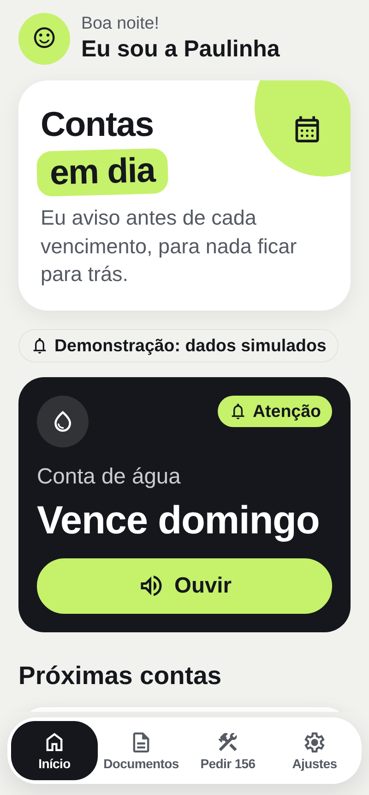
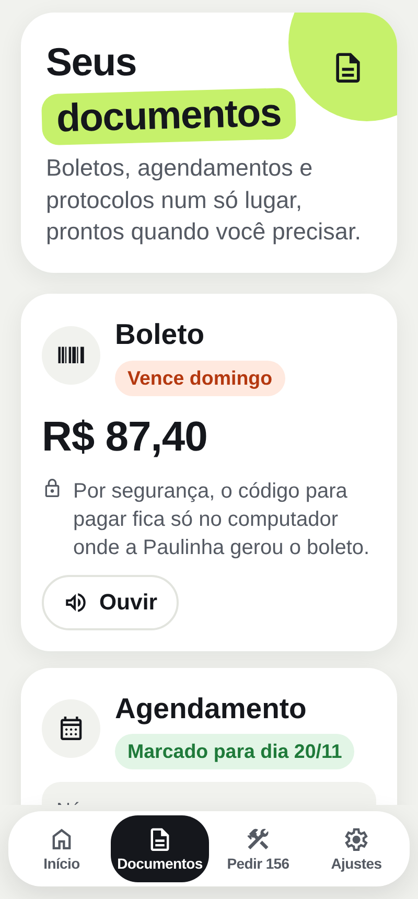
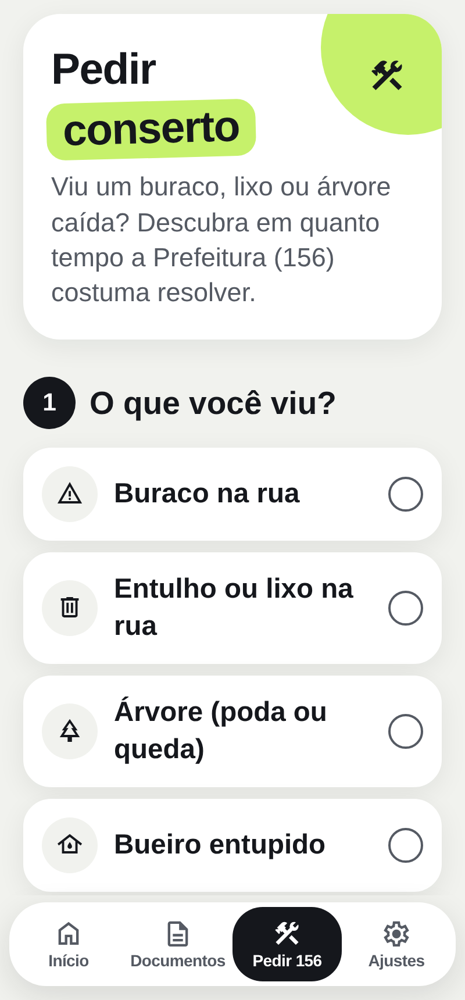
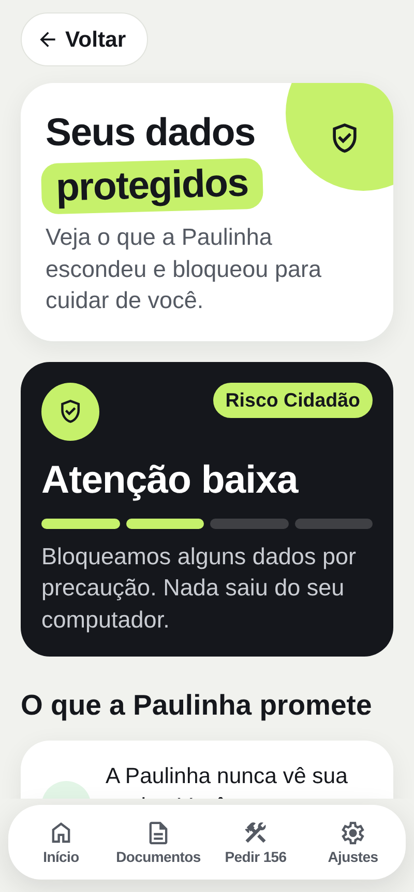

# SampaIA — app do celular

Companheiro da Paulinha no celular: mostra o que vence, o que o agente já fez e permite pedir conserto ao 156 com foto, já com a previsão de prazo do modelo de ML.

## Ficha da CitizenTech

A ficha completa (problema, cidadão beneficiado, cidade, ecossistema, indicador de impacto, ODS e integrantes) está no [README principal](../README.md#ficha-da-citizentech).

**Vídeo do app (até 3 min):** [`videos/mobile-app.mp4`](../videos/mobile-app.mp4) · YouTube: https://youtu.be/q22QP1ius8Y

## Telas

| Tela | Rota | O que tem |
|---|---|---|
| Início | `/` | Próximos vencimentos em cartões grandes, com botão "Ouvir" |
| Documentos | `/documentos` | Boletos, agendamentos e protocolos; copiar número |
| Pedido ao 156 | `/pedido` | Tipo do problema, foto (`expo-camera`), bairro (`expo-location`) e previsão de prazo |
| O que a Paulinha fez | `/tarefas` | Histórico do agente com estado e passos |
| Segurança | `/seguranca` | Risco Cidadão e eventos explicados em linguagem simples |
| Ajustes | `/ajustes` | Tamanho da letra, alto contraste, leitura em voz alta |

| Início | Documentos | Pedido ao 156 | Segurança |
|---|---|---|---|
|  |  |  |  |

## Como rodar

```bash
cd mobile
npm install
npx expo start          # abra no Expo Go (QR code) ou aperte "w" para web
npm test                # teste das frases de vencimento
```

**Modo demonstração:** sem `.env`, o app usa dados simulados e roda sozinho.
**Com as APIs:** copie `.env.example` para `.env` e coloque o IP do computador onde rodam as APIs (portas 5009 e 5010).

## Acessibilidade

- Fonte base 18, com opções "Grande" (padrão) e "Enorme"; botões com 56 dp de altura.
- `accessibilityRole` e `accessibilityLabel` em todo elemento tocável; cartões lidos como uma frase só.
- Contraste mínimo 4,5:1 (azul `#0b4f9c` sobre branco: 8,6:1) e modo de alto contraste (preto, branco e amarelo).
- `expo-speech` lê vencimentos e documentos em voz alta.
- Linguagem simples: "Conta de água vence sexta", nunca "Fatura pendente PDE nº".

## Dados e privacidade

- TanStack Query busca as listas; a última resposta fica guardada no `expo-sqlite`, então o app mostra os dados mesmo sem internet.
- `expo-notifications` agenda um aviso local às 9h da véspera de cada vencimento.
- O pedido ao 156 envia à API só o **tipo** e o **bairro**. Foto e coordenada exata ficam no celular.
- Linha digitável e Pix nunca saem do computador onde a Paulinha gerou o boleto (regra de PII), por isso o app mostra valor e data, não o código de pagamento.
